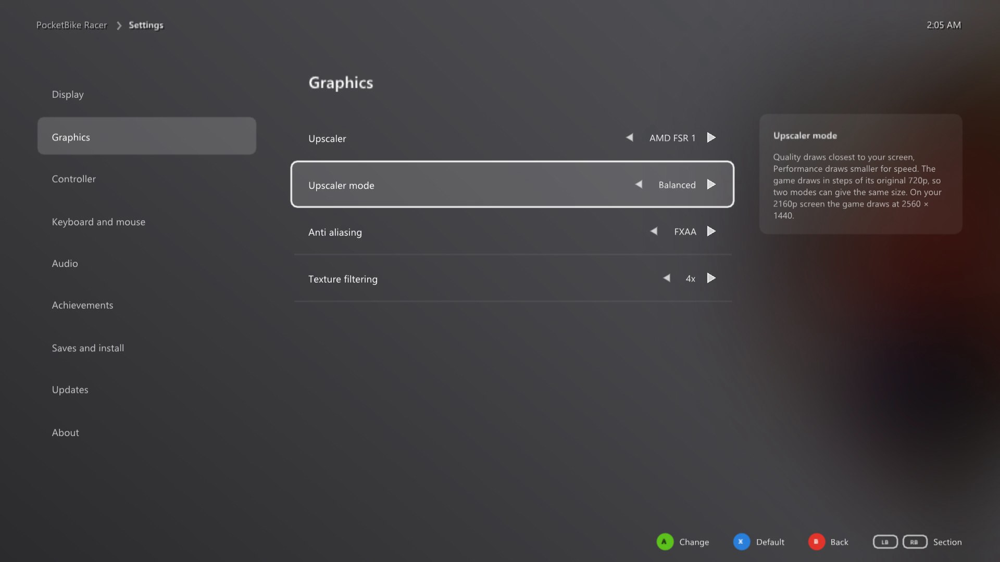
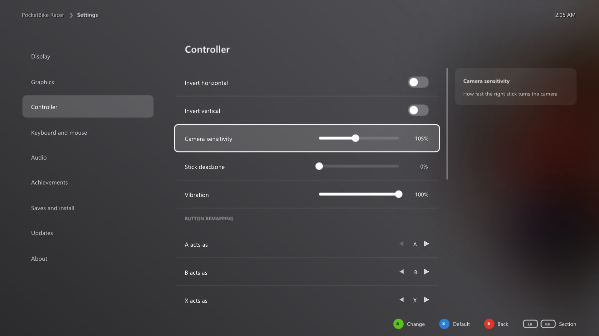
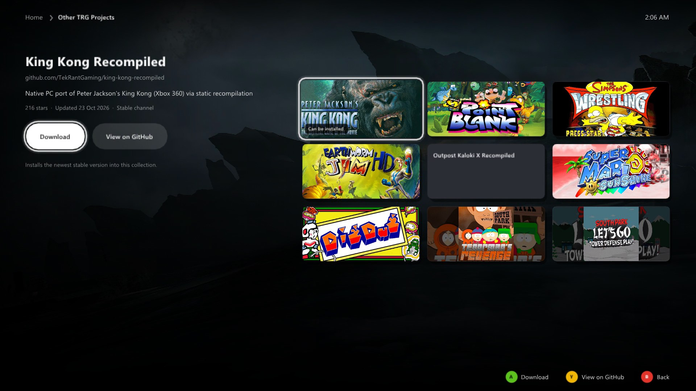

# TRG Launcher 2.0

A console style dashboard that starts one or more recompiled games. It began as the launcher of
[The Whopping Recompilation Collection](https://github.com/TekRantGaming/whopping-recompilation-collection)
(three Burger King Xbox 360 games) and grew Xbox Live Arcade package installs in Trials: The Recompilation
Collection. A project describes itself in one file; everything else comes from here.


| A game's page | Settings |
| --- | --- |
|  |  |
| **Your copy of the game** | **Achievements** |
|  |  |
| **Controller settings** | **Other TRG Projects** |
|  |  |

## 1.x or 2.0?

Both live in this repository and both are kept. Pick per project:

| | TRG Launcher 1.x (`trg::launcher`) | TRG Launcher 2.0 (`trg::launcher2`) |
| --- | --- | --- |
| Shape | a settings window before one game | a dashboard for one game or a collection |
| You write | the pages and rows, in code | one `ProjectConfig` |
| Hosts | inside the game's own ImGui frame, or its own window | its own window (SDL2 + OpenGL 3), as a separate program that starts the games |
| Install from | a disc image (with the helpers) | the player's disc image or Xbox Live Arcade package, found on the PC or picked |
| Also | themes, header scenes, a pop up before Play | game art, Other TRG Projects, Add to Steam, Discord, achievements, save backups, game and launcher updates, controller first navigation, a Linux AppImage path |

2.0 is built on the 1.x library (its settings stores, Xbox 360 disc reader, downloads and updater), so a fix there
reaches both. Projects that already use 1.x change nothing: 2.0 is only built when `TRG_LAUNCHER_2` is on.

## What players get

* **Home:** the focused game's art fills the screen with its logo and status; the games are tiles along the bottom,
  then Other TRG Projects, Add to Steam, Discord, Settings and Exit. LB and RB switch games, A opens.
* **A game's page:** Play (or Download or Install), settings, achievements, saves, updates.
* **Settings per game,** in sections: display, graphics (upscaler modes), controller (invert, sensitivity, deadzone,
  vibration, button remapping), keyboard and mouse with key binding, audio, achievements with in game notifications,
  saves (back up, restore, delete) and install, updates, about. Each game gets its own settings file.
* **Your copy of the game:** disc images or packages found on the PC are offered as buttons (a file window cannot be
  used with a controller), or the player picks or drops the file. Only the title ID is checked. The supported copy's
  facts are shown beside it.
* **Updates:** each game updates itself from the project's releases at start; the launcher installs its own update
  and restarts into it when nothing else is going on.
* **Getting back:** while a game runs the launcher steps aside; holding Back and Start (or Esc) in game closes the
  game and the launcher returns.
* **Portable:** everything is kept beside the launcher, so the folder can be moved or deleted as one, and launchers
  such as Quiver can run it from anywhere.

## Adding it to a project

1. Add this repository:

   ```bash
   git submodule add https://github.com/TekRantGaming/trg-launcher.git third_party/trg-launcher
   ```

2. Copy [`examples/whopping`](examples/whopping) into your project: `project.cpp`, `launcher.rc` and the
   CMake lines. Make your logo header (below) and change every value in `project.cpp`.

3. CMake:

   ```cmake
   set(TRG_LAUNCHER_STANDALONE ON CACHE BOOL "" FORCE)
   set(TRG_LAUNCHER_BUILD_DEMO OFF CACHE BOOL "" FORCE)
   set(TRG_LAUNCHER_2 ON CACHE BOOL "" FORCE)
   add_subdirectory(third_party/trg-launcher)

   add_executable(my_launcher WIN32 src/project.cpp src/launcher.rc)
   target_link_libraries(my_launcher PRIVATE trg::launcher2)
   target_compile_definitions(my_launcher PRIVATE PROJECT_VERSION="1.0.0" PROJECT_VERSION_COMMAS=1,0,0,0)
   if(MSVC)
     target_link_options(my_launcher PRIVATE /ENTRY:mainCRTStartup)  # a window program that starts at main()
   endif()
   ```

   The Whopping collection also links the C runtime in (`CMAKE_MSVC_RUNTIME_LIBRARY` set to
   `MultiThreaded$<$<CONFIG:Debug>:Debug>`) so the launcher runs on its own, and reads the version from a `VERSION`
   file that its release script checks.

4. `main` hands the config over:

   ```cpp
   #include <trg/hub.h>

   int main(int argc, char** argv) { return trg::hub::Run(MyProject(), argc, argv); }
   ```

5. Add the game side hooks to each game ([game_side/README.md](game_side/README.md)), or turn off the features your
   games do not have (`ProjectConfig::features`).

Build this repository on its own with `build.bat`: it builds the 1.x demo and the 2.0 example
(`build\launcher2\examples\whopping\whopping_launcher.exe`).

## The project file

Every field is described in [`include/trg/hub.h`](include/trg/hub.h). In short:

| Field | Example | Used for |
| --- | --- | --- |
| `name` | `The Whopping Recompilation Collection` | window title, Steam shortcut name, settings files |
| `id` | `whopping` | the launcher's settings file (`whopping.txt`) and temporary file names |
| `version` | `PROJECT_VERSION` | shown on Home and in Settings, compared with releases |
| `home_line`, `about`, `made_by`, `console`, `region` | | text on Home, About and the install page |
| `logo_png`, `logo_png_size` | `kWhoppingLogoPng` | the wordmark at the top of Home |
| `games` | one `GameInfo` per game | everything about each game (below) |
| `repo`, `packages_tag_prefix`, `launcher_zip`, `launcher_exe` | `TekRantGaming/whopping-recompilation-collection`, `packages-v`, `WhoppingCollection`, `whopping_launcher` | where updates come from and what they are called |
| `linux_data_folder` | `whopping_collection` | the launcher's data folder on Linux |
| `setting_prefix`, `from_launcher_flag` | `bk_`, `--bk_from_launcher=true` | the contract with the game side hooks |
| `test_background_env`, `release_server_env` | `BK_TEST_BACKGROUND`, `WHOPPING_RELEASE_SERVER` | test runs (below) |
| `features` | all on | rows that need game side hooks, and `output_resolution` (below) |
| `discord_url`, `steam_art_base`, `other_projects` | | Home's tiles; an empty value hides its tile |

A `GameInfo` holds the game's `id` (its folder, settings and save folder name, and the ReXGlue app name), title,
exe, release zip name, Xbox 360 title ID, colour and tagline, its `InstallSource` (`kDisc` or `kPackage`), its art,
the facts of the copy the port was made with, and `own_mouse_look` for a game whose own hook turns the camera with
the mouse.

### Resolution

Display has one **Resolution** row (Your screen, 1280 × 720, 1920 × 1080, 2560 × 1440, 3840 × 2160; 1920 × 1080 by
default) instead of separate Window size and Render resolution rows: the size the game is drawn at and shown, and the
size of its window when windowed. The launcher writes it as `window_width`/`window_height`, the guest video mode and
`resolution_scale` (the draw scale from 720p, or the game's own video mode for the heights in
`GameInfo::native_heights`), and before the first Play too. The upscaler modes scale from it as well, in the launcher's
text and in `game_side/shared/render_quality.cpp`. Set `features.output_resolution = false` for the two separate rows.
From Angry Birds: The Re-Hatched Collection.

### The copy's facts

The install page and the About section show the copy the port was made with: version, file name, size, SHA1, MD5,
CRC32, media ID and installed size. Hash the image or package you made the port from (`certutil -hashfile <file>
SHA1`, and the same with MD5; any CRC32 tool), take the version and media ID from its `default.xex` (the execution
info header), and measure the installed `game` folder. Only the title ID is checked when a player installs, so any
good copy of the same game works.

## Game art

The art is downloaded from SteamGridDB's image server, which serves images to anyone without an API key, and cached
in `cache/art/<SteamGridDB id>/`, so each image is downloaded once. Until it arrives, tiles are drawn in the game's
colour with its title, and the launcher works offline from the cache.

To pick a game's art:

1. Find the game on [steamgriddb.com](https://www.steamgriddb.com) and note the number in its address
   (`https://www.steamgriddb.com/game/5315547`): that is `steamgriddb_id`.
2. On its Grids tab choose a 600 x 900 portrait card; on Heroes a 1920 x 620 background; on Logos a transparent logo.
3. Open each image and copy the part of its address after `https://cdn2.steamgriddb.com/`, such as
   `grid/1acc3f304807556a4aa25c38b681210b.png`, into `art_grid`, `art_hero` and `art_logo`.

Keep a few alternatives in a comment beside them (the example does), so swapping one later is quick.

Other TRG Projects uses full image addresses (`OtherProject::grid_url`, `hero_url`). Its descriptions, stars and
last update come from the GitHub API and are cached in `cache/projects` for a day, because GitHub allows only 60
unauthenticated requests an hour per internet address, shared by every program on that connection.
`trg::hub::TrgProjects()` is the current TekRantGaming list; pass your own list, or an empty one to hide the tile.

## Add to Steam artwork

Add to Steam writes a shortcut for the launcher into Steam's `shortcuts.vdf` (the existing entries are kept and a
backup is made), turns Steam Input off for it (otherwise the controller stops working when started from Steam),
saves five pictures under the shortcut's app ID, and closes and reopens Steam, which only reads its list at start.
The pictures are the project's own, made from its logo and screenshots, committed to its repository and downloaded
from `steam_art_base`:

| File | Size | Steam's name for it |
| --- | --- | --- |
| `cover.png` | 600 x 900 | the library capsule |
| `wide.png` | 920 x 430 | the wide capsule |
| `hero.png` | 1920 x 620 | the header behind the game's page |
| `logo.png` | transparent (1400 x 440 in the example) | the logo over the header |
| `icon.png` | 512 x 512 | the icon |

The Whopping collection keeps them in `docs/steam/` and sets
`steam_art_base = "https://raw.githubusercontent.com/TekRantGaming/whopping-recompilation-collection/main/docs/steam/"`.
Only PNGs are saved, so an error page never becomes artwork. Test Add to Steam on a fake Steam folder with an
existing shortcut, never on your own Steam.

## The logo

Home draws the project's wordmark from PNG bytes compiled in:

```bash
python launcher2/tools/png_to_header.py logo.png src/logo_png.h kMyLogoPng
```

The Whopping collection's logo is an HTML page rendered to a transparent PNG by a headless browser
(its `tools/logo`), so the text stays sharp at any size.

## Folders

On Windows everything stays beside the launcher:

```
whopping_launcher.exe
whopping.txt                 the launcher's own settings
games/<id>/                  each game's program files (from the release zip)
games/<id>/game/             the files from the player's disc or package
games/<id>/<id>.toml         the game's settings, written by the launcher, read by the game at start
save-backups/<id>/           save backups made from the Saves section
cache/                       art, Other TRG Projects, downloads
Documents/<id>/              the game's saves, where the ReXGlue runtime keeps them
```

On Linux the launcher and the games are inside the AppImage, so the launcher keeps its data in
`XDG_DATA_HOME/<linux_data_folder>`, and each game's settings and saves live in `XDG_DATA_HOME/<id>`.

## Releases and updates

Players should see one download, and the launcher needs many files. So each version has two releases:

| Release | Tag | Holds |
| --- | --- | --- |
| for players (latest) | `v1.0.6` | `WhoppingCollection-v1.0.6-windows-x64.zip` (the portable launcher with every game already in `games/`), and the Linux AppImage |
| for the launcher (never latest) | `packages-v1.0.6` | the launcher's own update zip, each game's `<zip_folder>-v1.0.6-windows-x64.zip`, the AppImage, and `SHA256SUMS.txt` |

Create the packages release first, so the players' release is the newest on the page. Every zip holds an
`update-files.txt` made by [`tools/make_update_files.py`](../tools/make_update_files.py), so an update replaces exactly
the release's files and never the protected ones (the player's game files, settings, saves, backups and caches).
`SHA256SUMS.txt` uses Windows line ends and two spaces between hash and name. The Whopping collection's release
script, [`examples/whopping/tools/make_release.ps1`](examples/whopping/tools/make_release.ps1), builds both
layouts; change its names and paths for your project. See [docs/UPDATER.md](../docs/UPDATER.md) for the updater
itself.

On Linux the games update with the launcher: the game updaters are off and the launcher's updater replaces the whole
AppImage.

## Linux

The launcher builds for Linux with clang. In the AppImage, every program goes in `usr/bin` (the games beside the
launcher, linked with `$ORIGIN` as their library path), the bundled Noto Sans fonts in `usr/share/fonts`
(the launcher looks there first; [`linux/fonts`](linux/fonts) has them with their licence), and `AppRun` runs from a
copy so Steam stopping a game cannot unmount the files under it. The Whopping collection's scripts are in
[`examples/whopping/tools/linux`](examples/whopping/tools/linux). The playbook's Linux chapter has the rest.

## Testing

The launcher has switches for scripted checks that never need the screen:

| Switch | Does |
| --- | --- |
| `--screenshot out.bmp` | draws in a hidden window, saves the last frame and quits |
| `--view home`, `hub:<n>`, `game:<n>:0`, `install:<n>`, `settings`, `projects` | the screen to start on |
| `--press rb,rb,a` | controller presses, one after another (up, down, left, right, a, b, x, y, lb, rb, start) |
| `--frames <n>` | frames drawn before the screenshot |
| `--offline` | no downloads or update checks; cached art still shows |
| `--test-install <n> <file or folder>` | installs game n from that copy and quits |
| `--test-play <n>` | starts game n as Play does, with a private user folder, and quits when it closes |
| `--test-download <n>` | downloads or updates game n and writes the result to `download-test.txt` |
| `--release-server <url>` | asks that server for releases instead of GitHub (also `release_server_env`) |

Run tests from a copy of the launcher in a folder of their own, and copy a warm `cache` folder into it first, so a
run of fresh folders does not use up the GitHub allowance of everyone on your connection. Set `test_background_env`
so neither the launcher's file window nor the games take the screen.

## What is in this folder

| Path | |
| --- | --- |
| `include/trg/hub.h` | the project file's types and `Run` |
| `src/` | the launcher (screens, installs, art, updates, Steam, saves) |
| `examples/whopping/` | The Whopping Recompilation Collection's project file, resource file, logo and scripts |
| `game_side/` | the hooks each game needs, and examples from Sneak King |
| `linux/fonts/` | Noto Sans for the AppImage (OFL 1.1) |
| `tools/png_to_header.py` | the logo header |
